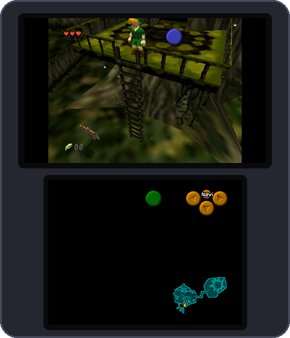
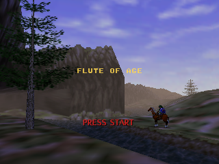
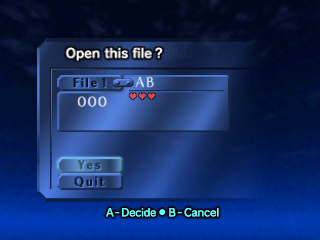
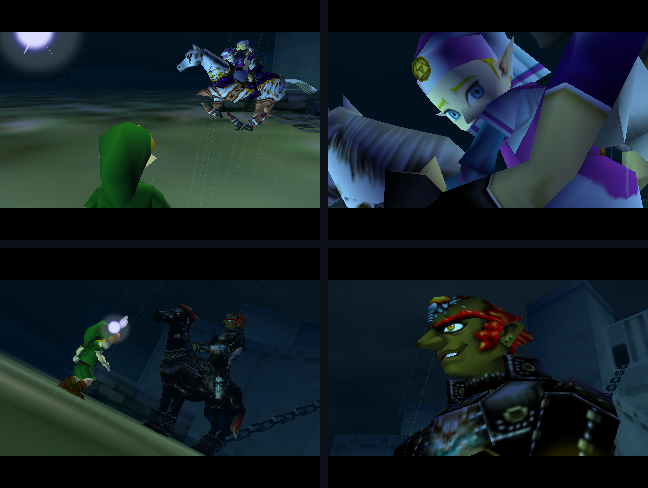
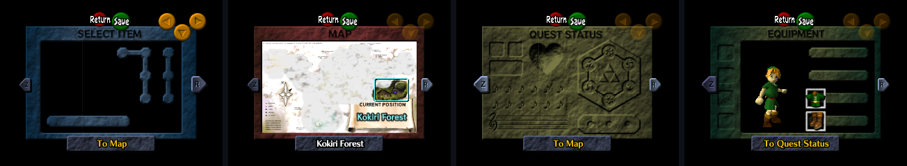
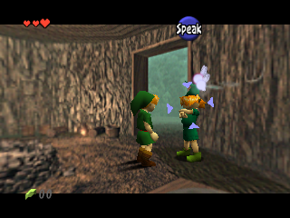
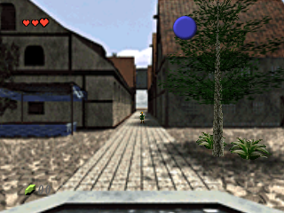
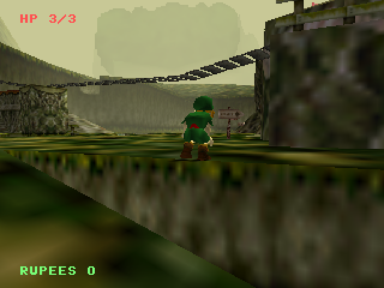
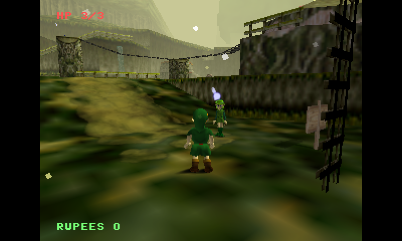
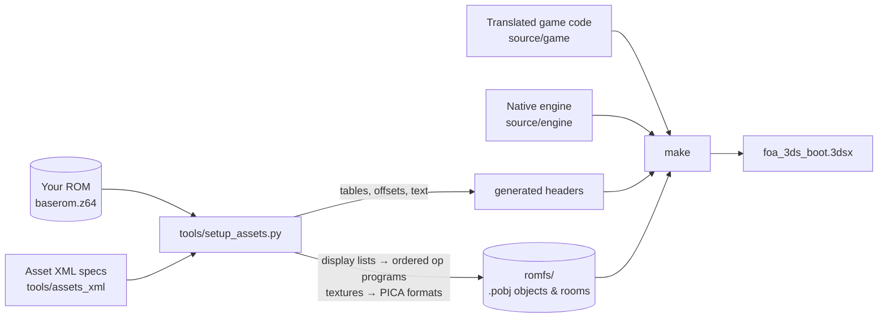

<div align="center">

# 🎶 Flute of Age — native 2DS port

**A from-source, native Nintendo 2DS / 3DS port of the *Flute of Age* decompilation —<br>no emulator, no N64 compatibility layer: the game's own code, translated and running on the 3DS hardware.**




[What works](#-what-works) · [Screenshots](#-screenshots) · [Setup guide](#-setup-guide) · [How to play](#-how-to-play) · [How it works](#-how-it-works) · [Roadmap](#-roadmap)

</div>

> [!IMPORTANT]
> **This repository contains no game data.** You need your own legally obtained copy of the game ROM
> (**NTSC 1.0, US**). Every texture, model, scene, sound and text is converted on *your* machine from
> *your* ROM by the tools in this repository, and is never committed. Do not share built `.3dsx` files:
> they contain the converted game data.

---

## ✨ What works

<table>
<tr><td valign="top" width="50%">

**🎮 Game**
- ✅ The decompiled game code, translated to C and running natively (hardware float, original math order)
- ✅ The real `Play` state: scenes, rooms, collision, camera, time of day, actors
- ✅ The player: the original `z_player.c`, all 16 000 lines
- ✅ Title screen with the attract demo, file select, name entry, saves
- ✅ All cutscene scripts; the new-game intro nightmare with Zelda, Impa and Ganondorf
- ✅ The first area's actors: Sylvan children, Sylva, Milo, fairies, signs, grass, rocks, Gossip Stones, Skulltulas
- 🚧 Actors outside the first area are skipped for now (each logged once)
- 🚧 Audio (silent for now)

</td><td valign="top" width="50%">

**🖼 Graphics & presentation**
- ✅ Full-fidelity renderer: original draw order, the two-cycle colour combiner on the PICA200 TEV, fog, lighting, environment maps, both texture layers, all 71 render presets
- ✅ **60 fps**: logic at the original 20 Hz, every retrace presented with camera, models and skeletons blended between game frames
- ✅ Skyboxes, skinned meshes (horses), cloth (Ganondorf's cape)
- ✅ Prerendered rooms: interiors, the market, behind the 3D characters
- ✅ **Two screens**: the game, hearts, rupees and the A button on top; the B / C buttons, the minimap and the **pause menu** on the bottom, by touch or buttons
- ✅ Text boxes, lock-on reticle, letterbox bars, the beating heart

</td></tr>
</table>

## 📸 Screenshots

<table>
<tr>
<td align="center"><br><sub>The title screen's attract demo</sub></td>
<td align="center"><br><sub>File select</sub></td>
</tr>
<tr>
<td align="center" colspan="2"><br><sub>The new-game intro: Zelda and Impa flee the castle, Ganondorf gives chase</sub></td>
</tr>
<tr>
<td align="center" colspan="2"><br><sub>The pause menu lives on the bottom screen: Select Item, Map, Quest Status, Equipment (with the live preview)</sub></td>
</tr>
<tr>
<td align="center"><br><sub>Locked on: reticle and letterbox bars</sub></td>
<td align="center"><br><sub>A prerendered background (the market)</sub></td>
</tr>
<tr>
<td align="center"><br><sub>Running through Sylvan Forest</sub></td>
<td align="center"><br><sub>A Sylvan child (head, body and legs from three objects) and a fairy</sub></td>
</tr>
</table>

<p align="center"><br><sub>A scripted run, captured headlessly every ~2 s</sub></p>

---

## 🛠 Setup guide

You will build the game yourself: install a toolchain, add your ROM, convert the data, compile.
Plan ~20 minutes for the first time.

### Step 1 — Install the tools

| Tool | Version | Why |
|---|---|---|
| **devkitPro** with the `3ds-dev` group | current | ARM compiler, libctru, citro3d, picasso (shader assembler) |
| **Python** | 3.10 or newer | the asset converters (standard library only — no packages to install) |
| **git** | any | to clone this repository |

<details open>
<summary><b>🪟 Windows</b></summary>

1. Download the **devkitPro installer** from <https://github.com/devkitPro/installer/releases> and run it.
2. When asked which components to install, tick **3DS Development**.
3. Install **Python** from <https://www.python.org/downloads/> (tick *“Add python.exe to PATH”*).
4. Open the **MSYS2 shell from the devkitPro start-menu folder** for the next steps (it has `make` and the toolchain on its path).

</details>

<details>
<summary><b>🐧 Linux / 🍎 macOS</b></summary>

1. Install devkitPro's pacman: follow <https://devkitpro.org/wiki/devkitPro_pacman>.
2. Install the 3DS toolchain:
   ```bash
   sudo dkp-pacman -S 3ds-dev
   ```
3. Make sure `DEVKITPRO` and `DEVKITARM` are set (log out and back in after installing, or `source /etc/profile.d/devkit-env.sh`).
4. Install Python 3.10+ from your package manager.

</details>

### Step 2 — Get the code

```bash
git clone https://github.com/Smartdude400/flute-of-age-2ds.git
cd flute-of-age-2ds
```

### Step 3 — Add your ROM

Copy your ROM into the repository root and name it **`baserom.z64`**.

| Requirement | Value |
|---|---|
| Version | NTSC 1.0 (US) |
| Format | `.z64` (big-endian) |
| MD5 | `5bd1fe107bf8106b2ab6650abecd54d6` |

> [!TIP]
> Keep the ROM elsewhere? Set the `FOA_BASEROM` environment variable to its path instead of copying it.
> `baserom.z64` is in `.gitignore`, so it can never be committed by accident.

### Step 4 — Convert the game data

```bash
python tools/setup_assets.py
```

This checks the ROM, then converts everything into native 2DS formats: every object, all 111 scenes,
textures, skies, text and render presets (about 50 MB in `romfs/`). It also generates the headers that
depend on the ROM. It takes about a minute and only has to be run once.

### Step 5 — Build

```bash
make BOOT=0xEE
```

This produces **`foa_3ds_boot.3dsx`**: the playable demo, which starts in Sylvan Forest with a new file.

| Command | Output | What it is |
|---|---|---|
| `make BOOT=0xEE` | `foa_3ds_boot.3dsx` | **The demo**: a new file, straight into Sylvan Forest |
| `make` | `foa_3ds.3dsx` | The full boot: title screen, file select, the intro |
| `make FILESELECT=1` | `foa_3ds_fs.3dsx` | Boots straight into file select |
| `make INSPECT=1` | `foa_3ds_inspect.3dsx` | The [asset inspector](docs/INSPECTOR.md): every object and scene, with captures |
| `make HARNESS=1` / `HARNESS=2` | `foa_3ds_h1/h2.3dsx` | Renderer tests: player-model viewer, free-fly scene viewer |
| `make PRESENT20=1` | | The original 20 fps pacing instead of 60 fps |

> [!NOTE]
> On Windows without the devkitPro shell, `./build.sh BOOT=0xEE` runs the same `make` through MSYS2.

---

## 🎮 How to play

### On a real 2DS / 3DS

1. Your console needs **homebrew access** (the Homebrew Launcher, e.g. through Luma3DS).
2. Copy `foa_3ds_boot.3dsx` to the SD card, into **`/3ds/`**.
3. Start the **Homebrew Launcher** and pick **Flute of Age**.

### On an emulator (Azahar)

1. Install [Azahar](https://azahar-emu.org/).
2. **File → Load File…** and choose `foa_3ds_boot.3dsx`.

### Controls

| 2DS / 3DS | Original controller | In game |
|---|---|---|
| Circle Pad | Control stick | Move (analog) |
| **A** | A | Action / roll / talk |
| **B** | B | Sword |
| **L** | Z | Target / centre camera |
| **R** | R | Shield |
| **D-Pad** | C-buttons | Items / first-person (up) |
| **X** / **Y** | C-up / C-left | Alternatives for the D-Pad |
| **START** | START | Pause menu (on the bottom screen) |
| Touch screen | — | Tap the B / C buttons to use them; in the pause menu tap the arrows to change pages, an item to select it (then tap a C button to assign it), an equipment twice to equip it |

---

## 🧠 How it works

The port follows one rule: **no emulation**. Nothing original is interpreted at run time: no display
lists, no N64 texture formats, no RSP microcode. The game *logic* is translated; the game *data* is
converted ahead of time into formats the 3DS GPU uses directly.



| Layer | What it does |
|---|---|
| `source/game/` | The game's code translated to C: platform calls replaced, logic and math order kept exactly |
| `source/engine/` | The native platform layer: fixed-timestep runner, input, RomFS loading, saves, memory arenas |
| `source/engine/gfx3d.c` | Renderer: records draw calls per buffer (opaque / translucent / overlay) and replays them in the original order on the PICA200 |
| `source/engine/tev.c` | Maps the N64 two-cycle colour combiner `(A−B)·C+D` onto the 6 PICA texture-combiner stages |
| `source/shaders/gfx3d.v.pica` | Vertex shader: per-vertex matrix palette (skinned skeletons), lighting, texgen, tile transforms |
| `tools/dl2pica.py` | Offline display-list compiler: keeps every state change in original order, decodes all fields into native enums |

Read more in [`docs/ARCHITECTURE.md`](docs/ARCHITECTURE.md), the open stub list in
[`docs/STUBS.md`](docs/STUBS.md), and the full engineering diary in [`docs/RESEARCH_LOG.md`](docs/RESEARCH_LOG.md).

## 🗂 Repository layout

```
├── source/
│   ├── game/          translated game code (states, actors, player, scenes, environment, …)
│   ├── engine/        native platform layer + renderer
│   ├── shaders/       PICA200 vertex shaders (picasso)
│   └── test/          renderer test harnesses
├── tools/
│   ├── setup_assets.py   ← run this once (converts your ROM)
│   ├── dl2pica.py        display-list compiler
│   ├── build_*.py        object / scene / sky / text converters
│   ├── run_test.py       headless test runner (Azahar on a hidden desktop + RPC)
│   ├── assets_xml/       asset XML specs (names and offsets inside the ROM files)
│   ├── romdata/          ROM layout (file table)
│   └── patches/ …        porting scripts (need the original decompilation checkout)
├── trace/inputs/       scripted input for repeatable test runs
└── docs/               architecture, stubs, research log, images
```

## 🧪 Testing headlessly (optional)

`tools/run_test.py` runs a build in Azahar on a hidden Windows desktop and drives it through Azahar's
RPC server: it waits for N game frames, takes screenshots and prints the game's log.

```bash
python tools/run_test.py foa_3ds_boot.3dsx --frames 240 --script trace/inputs/p3_walk.txt --shot walk.png --shots 60,120
```

It needs a portable Azahar folder (`azahar.exe` plus a `user/` folder whose `config/qt-config.ini` has
`enable_rpc_server=true` and `use_vsync=false`); point `FOA_AZAHAR_DIR` at it.

## 🔍 Asset inspector

`./build.sh INSPECT=1` builds `foa_3ds_inspect.3dsx`. Use it to browse every object part by part, fly through the scenes and capture graphics mistakes with the exact camera position (see [docs/INSPECTOR.md](docs/INSPECTOR.md)).

## 🧭 Roadmap

- [x] Native engine layer, fixed-timestep runner, saves
- [x] Offline display-list compiler + full-fidelity PICA200 renderer
- [x] Skyboxes, render presets, original draw order
- [x] The real `Play` state with the player
- [x] Actors of the first area (Sylvan children, the fairy companion, doors, grass, signs …)
- [x] Cutscene data (the title-screen demo still needs its actors and sky)
- [x] The real HUD and text boxes
- [x] File select
- [x] Title screen
- [x] Skinned meshes (horses)
- [x] Pause menu (bottom screen, touch)
- [x] The new-game intro (nightmare cutscene actors, cloth)
- [x] Asset inspector (browse, capture, survey every object)
- [ ] Audio (sequence player + synthesis on the ARM11, output through the DSP)
- [x] Prerendered backgrounds (interiors, market)
- [x] 60 fps presentation (frame interpolation; game logic stays at the original 20 Hz)
- [ ] Frame-perfect equivalence traces against the original

## ❓ Troubleshooting

<details>
<summary><b>“ROM check failed”</b></summary>

The MD5 must match NTSC 1.0 US exactly. If your dump is `.n64` (little-endian) or `.v64` (byte-swapped),
convert it to `.z64` first, e.g. for `.v64`:

```python
d = bytearray(open("rom.v64", "rb").read()); d[0::2], d[1::2] = d[1::2], d[0::2]; open("baserom.z64", "wb").write(d)
```
</details>

<details>
<summary><b><code>make: arm-none-eabi-gcc: not found</code></b></summary>

The devkitPro environment isn't loaded. Use the devkitPro MSYS2 shell on Windows; on Linux/macOS
`source /etc/profile.d/devkit-env.sh`.
</details>

<details>
<summary><b>Compile errors about missing <code>assets_agg/…</code> or <code>segment_symbols.h</code></b></summary>

Those headers are generated from your ROM: run `python tools/setup_assets.py` before `make`.
</details>

<details>
<summary><b>The log shows “[ACTOR] id … not ported”</b></summary>

Expected outside the first area: actors that are not ported yet are skipped and logged once.
</details>

---

## ⚖️ Legal

This is a non-commercial fan project for research and preservation. It is **not affiliated with or
endorsed by Nintendo**. The game code here is a translation of a community decompilation project;
the original game, its code, assets and trademarks belong to their respective owners. **No game data
is included**: you must supply your own legally obtained ROM, and you must not distribute builds made
from it. Third-party library notices: [`THIRD_PARTY.md`](THIRD_PARTY.md).

<div align="center"><sub>Built with devkitARM · libctru · citro3d · picasso — tested on Azahar and designed for the original 2DS</sub></div>
